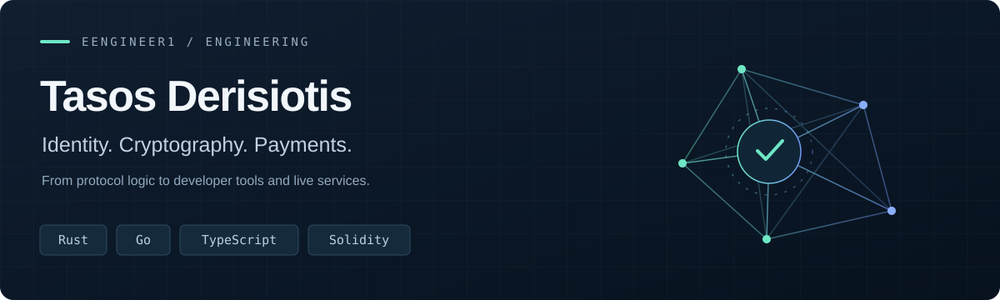

  

  <a href="#selected-projects">Selected projects</a> ·
  <a href="#selected-contributions">Selected contributions</a> ·
  <a href="#technical-stack">Technical stack</a>

## Hi, I'm Tasos

I build across **decentralized identity, applied cryptography, and payments** — from blockchain modules and signing flows to SDKs, APIs, and the services around them.

My work at **cheqd** spans the Go ledger, TypeScript SDK, DID infrastructure, credential tooling, and payment integrations. My own repositories explore selective disclosure, Solana escrow and settlement, and Ethereum smart contracts.

**Rust · Go · TypeScript · Solidity**  
**DIDs · Verifiable credentials · Selective disclosure · Cosmos SDK · Solana / Anchor · EVM**

## What I work on

| Focus | Engineering work |
| :--- | :--- |
| **Identity & trust** | DID lifecycle and resolution, document controllers, key rotation, credential issuance and verification, accreditation workflows. |
| **Applied cryptography** | Signature validation, key handling, SD-JWT disclosure and holder binding, BLS-network integrations for credential payments. |
| **Payments & settlement** | Transaction fees and fee abstraction, token escrow, marketplace settlement, subscription billing and migration. |
| **Protocol & developer infrastructure** | Cosmos SDK modules, IBC integrations, Anchor programs, typed SDKs, APIs, indexing, integration tests, and upgrade paths. |

## Selected projects

### Identity & privacy

| Repository | What to explore |
| :--- | :--- |
| **[sd-jwt-ts](https://github.com/Eengineer1/sd-jwt-ts)** · TypeScript | A type-rich SD-JWT implementation: issue, present, parse, and verify selectively disclosed credentials, with nested disclosures, decoy digests, and optional holder binding. |
| **[sd-jwt-veramo](https://github.com/Eengineer1/sd-jwt-veramo)** · TypeScript / Veramo | Bringing SD-JWT into identity agents: credential and presentation creation and verification through a Veramo plugin. |

### Payments & smart contracts

| Repository | What to explore |
| :--- | :--- |
| **[solana-defi-asset-marketplace](https://github.com/Eengineer1/solana-defi-asset-marketplace)** · Rust / Anchor / TypeScript | An escrow marketplace reference implementation with SPL Token / Token-2022 settlement, canonical metadata checks, seller/fee splits, a TypeScript SDK, Jupiter routing, and a PostgreSQL-backed indexer/API. |
| **[erc20-dollar-auctioning](https://github.com/Eengineer1/erc20-dollar-auctioning)** · Solidity | An earlier smart-contract project exploring ERC-20 dollar auction mechanics. |
| **[asset-tokenization](https://github.com/Eengineer1/asset-tokenization)** · Solidity / JavaScript | An earlier Ethereum project bringing together contracts, migrations, tests, and a client for asset tokenization. |

The Solana repository is a reference implementation; its architecture and security notes describe its boundaries. Deployment and audit status are documented in the repository.

## Selected contributions

Selected contributions across the identity and payments stack. The links below point to upstream repositories and merged pull requests.

| Layer | Contributions | Code & examples |
| :--- | :--- | :--- |
| **Ledger & transaction economics** · Go | Fee-market integration, IBC control-message fee bypass, fee-abstraction accounting, and upgrade/integration coverage. | [cheqd-node](https://github.com/cheqd/cheqd-node) · [Fee market #786](https://github.com/cheqd/cheqd-node/pull/786) · [IBC & fee abstraction #931](https://github.com/cheqd/cheqd-node/pull/931) |
| **DID signing & SDKs** · TypeScript | Authentication/signature validation, key-rotation handling, key generation, and Oracle-aware DID/resource fee pricing. | [sdk](https://github.com/cheqd/sdk) · [Signature validation #410](https://github.com/cheqd/sdk/pull/410) · [Oracle fees #507](https://github.com/cheqd/sdk/pull/507) |
| **DID resolution** · Go | Version-aware DID resolution metadata and resolver compatibility work. | [did-resolver](https://github.com/cheqd/did-resolver) · [Version metadata #239](https://github.com/cheqd/did-resolver/pull/239) |
| **Credential payments** · TypeScript / Veramo | Migration of timelock payments to an updated BLS network, preserving backwards-compatible reads. | [did-provider-cheqd](https://github.com/cheqd/did-provider-cheqd) · [BLS payment integration #399](https://github.com/cheqd/did-provider-cheqd/pull/399) |
| **Identity APIs & billing** · TypeScript | Accreditation-resolution caching and bounded concurrency; Stripe subscription plans, trials, and guarded migrations. | [studio](https://github.com/cheqd/studio) · [Accreditation performance #772](https://github.com/cheqd/studio/pull/772) · [Billing migration #816](https://github.com/cheqd/studio/pull/816) |
| **Registration & interoperability** · TypeScript / Go | DID Document `alsoKnownAs` support and IBC resource-query work for the AVIDA integration. | [Registrar #560](https://github.com/cheqd/did-registrar/pull/560) · [IBC resources #682](https://github.com/cheqd/cheqd-node/pull/682) |

  <a href="https://github.com/pulls?q=is%3Apr+is%3Amerged+author%3AEengineer1+org%3Acheqd">Explore my merged cheqd contributions →</a>

## Technical stack

| Area | Tools & technologies |
| :--- | :--- |
| **Languages** | Rust, Go, TypeScript, Solidity; Python and JavaScript for supporting tooling. |
| **Identity & cryptography** | DIDs, verifiable credentials, SD-JWT, JWT/JWS, Veramo, signature verification, key rotation, BLS-network integrations. |
| **Blockchain** | Cosmos SDK, CosmJS, IBC, Solana, Anchor, SPL Token / Token-2022, Ethereum / EVM. |
| **Services & integration** | Node.js, PostgreSQL, REST APIs, event indexing, Stripe, SDK packaging across ESM and CommonJS. |
| **Delivery** | Unit and integration testing, protocol upgrade tests, CI, architecture and developer documentation. |

---

  <strong>Identity people can use. Cryptography developers can integrate. Payments that connect the two.</strong>

